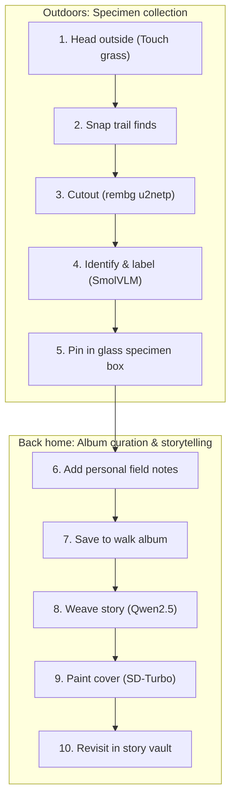
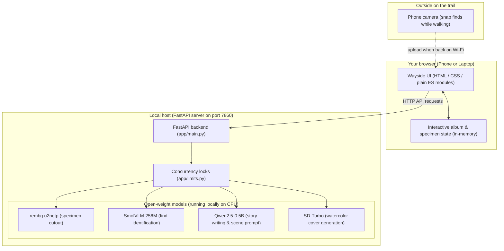

# Wayside

**Collect your walk.**


<!-- hero.png -->

Most outdoor AI apps want your attention on a screen: logging GPS coordinates, grinding streak counters, or squinting at maps. Wayside does the opposite. The screen is the shortest part of the experience; the walk is where the project happens.

You head outside, look around, and photograph small things that catch your eye—a scarlet maple leaf, an acorn with its cap askew, a smooth river pebble, a curious kitten. When you return, Wayside removes the background clutter, pins each find inside an interactive glass specimen box, and weaves your finds and personal notes into an illustrated storybook chapter with a custom watercolor cover.

---

## The "Touch Grass" philosophy

Built for the **Hacktoberfest Open-Source AI Challenge Week 1: Touch Grass**.

Wayside is designed to encourage stepping outside and observing the physical world:

* **Off the screen, into the path:** No leaderboards, badges, or notifications while walking. You simply snap photos of interesting finds and put your phone away.
* **Preserving small wonders:** Everyday curiosities often get lost in an overflowing camera roll. Wayside gives each find its own specimen box and story.
* **Open-source AI at the core:** Four open-weight models run directly on your own computer without third-party tracking, subscriptions, or proprietary cloud AI APIs.

---

## How it works



1. **Start your walk:** Head outdoors. Look closely at the ground, trees, and sidewalks for textures, shapes, and curiosities.
2. **Capture what intrigues you:** Photograph a leaf, a seed pod, a feather, or a storefront cat.
3. **Isolate the find:** When uploaded, `rembg (u2netp)` cleanly removes distracting pavement, soil, or grass backgrounds so the specimen stands alone.
4. **Meet your specimen:** A vision-language model (`SmolVLM-256M`) names the object and generates a descriptive one-line caption.
5. **Pin it in glass:** The find appears on an antique naturalist card inside a virtual wooden shadowbox with subtle physical tilt and shadow.
6. **Record your memories:** Add your own notes to each find (where you noticed it, what it smelled like, or why it caught your eye).
7. **Curate the walk album:** End the walk and name it to file it into your collection.
8. **Build the story:** Select which specimens to include, choose an atmosphere (*cozy*, *mystery*, *adventure*, *quiet*, or *spooky*), and set the place. A local language model (`Qwen2.5-0.5B`) weaves your finds and handwritten notes into a short narrative.
9. **Illustrate the cover:** Generate a cover image for your story. The language model extracts a key scene featuring your specimens in their setting, and `SD-Turbo` paints a 512×512 watercolor storybook illustration.
10. **Revisit in the vault:** Read through your illustrated scrapbook or listen to it read aloud.

---

## Interactive features

| Feature              | What it does                                                                           |
| :------------------- | :------------------------------------------------------------------------------------- |
| Interactive albums   | Start walks, collect finds on a shelf, name the walk, and browse past trips.           |
| Specimen shadowbox   | Every find is cut out, identified, captioned, and mounted on a physical-style card.    |
| Personal field notes | Jot down thoughts, locations, or sensory details for each specimen to guide the story. |
| Story builder        | Weave selected specimens into fiction with customized tone, setting, and pacing.       |
| Storybook covers     | Generates a 512×512 watercolor storybook cover based on your specimens and setting.   |
| Voice narration      | Built-in browser audio playback with play, pause, and resume controls.                 |
| Story vault          | Stores written tales and painted covers alongside each walk's specimen collection.     |
| Aesthetic themes     | Six curated color themes: Moss, Tide, Dusk, Blossom, Honey, and Night.                 |
| Responsive design    | Mobile bottom tab bar for phone use; dual-pane sidebar layout on desktop.              |

---

## The open models

Four open-weight models power the entire pipeline. No closed AI APIs are used.

| Step   | Model                               | Disk       | First call | Warm call | Licence                                                |
| :----- | :---------------------------------- | :--------- | :--------- | :-------- | :----------------------------------------------------- |
| Cutout | rembg (u2netp)                      | 4.4 MB     | 13.1 s     | 2.9 s     | MIT (u2net: Apache-2.0)                                |
| Label  | HuggingFaceTB/SmolVLM-256M-Instruct | 493.9 MB   | 27.8 s     | 31.2 s    | Apache-2.0                                             |
| Story  | Qwen/Qwen2.5-0.5B-Instruct          | 953.3 MB   | 85.3 s     | 5.1 s     | Apache-2.0                                             |
| Cover  | stabilityai/sd-turbo                | 4,922.4 MB | 62.0 s     | 25.4 s    | Stability AI Non-Commercial Research Community License |

---

## Why open innovation matters

* **Data stays on your machine:** Your photos, walk notes, and personal memories are never sent to third-party commercial clouds.
* **Zero running cost:** Small open-weight models run locally on consumer hardware without subscriptions, token billing, or API keys.
* **CPU friendly:** Compact models (`u2netp`, `SmolVLM-256M`, `Qwen2.5-0.5B`, `sd-turbo`) run comfortably on standard laptop processors.
* **Inspectable & swappable:** Model checkpoints can be audited, fine-tuned, or swapped via configuration.

---

## Architecture



---

## Quick start

### Prerequisites

* Python 3.10, 3.11, or 3.12
* Git
* At least 7 GB of free disk space for local model weights

### Installation steps

1. Clone the repository:

   ```bash
   git clone https://github.com/archangel2006/wayside.git
   cd wayside
   ```
2. Create and activate a virtual environment:

   * PowerShell:
     ```powershell
     python -m venv .venv
     .venv\Scripts\Activate.ps1
     ```
   * macOS / Linux:
     ```bash
     python3 -m venv .venv
     source .venv/bin/activate
     ```
3. Install required packages:

   ```bash
   pip install -r requirements.txt
   ```
4. Start the server:

   ```bash
   uvicorn app.main:app --host 0.0.0.0 --port 7860
   ```

Each model downloads on the first request to its respective endpoint:

* `rembg (u2netp)`: downloads on the first call to `POST /api/cutout` (cached in `~/.u2net` or `$U2NET_HOME`).
* `SmolVLM-256M-Instruct`: downloads on the first call to `POST /api/label` (cached in `~/.cache/huggingface/hub` or `$HF_HOME/hub`).
* `Qwen2.5-0.5B-Instruct`: downloads on the first call to `POST /api/story` (cached in `~/.cache/huggingface/hub` or `$HF_HOME/hub`).
* `sd-turbo`: downloads on the first call to `POST /api/cover` (cached in `~/.cache/huggingface/hub` or `$HF_HOME/hub`).

Download time depends on your connection. The first request to each step is slower because the model loads.

### Verify it works

Run the following command in a separate terminal:

```bash
curl http://127.0.0.1:7860/api/health
```

Expected output:

```json
{"status":"ok"}
```

Then open `http://127.0.0.1:7860` in your web browser to view the loading screen.

---

## Use it on a walk

The models execute on the laptop, and the phone opens the web page over local Wi-Fi. Albums reset on page reload, and the cover illustrates a scene featuring your specimens rather than copying your raw photos.

To connect a phone to the app:

1. Find your laptop local IP address:
   * PowerShell: `ipconfig` (look for the IPv4 address, for example `192.168.1.50`)
   * macOS / Linux: `ip a` or `ifconfig`
2. Connect both phone and laptop to the same Wi-Fi network.
3. Allow Python through the Windows Defender Firewall prompt for private networks when prompted.
4. If your router isolates wireless clients, turn on your phone mobile hotspot and connect your laptop to it.
5. Take photos with your phone camera during your outdoor walk.
6. When back on Wi-Fi within reach of the laptop, open `http://<laptop-ip>:7860` in your phone browser and add the photos from your gallery.

---

## Configuration

| Variable                    | Default                                         | Description                                                 |
| :-------------------------- | :---------------------------------------------- | :---------------------------------------------------------- |
| `PORT`                    | `7860`                                        | Server HTTP listening port                                  |
| `WAYSIDE_VISION_PROVIDER` | `local`                                       | Vision provider: `local`, `hf`, `fallback`                  |
| `WAYSIDE_STORY_PROVIDER`  | `local`                                       | Story provider: `local`, `hf`, `fallback`                   |
| `WAYSIDE_VISION_MODEL`    | `HuggingFaceTB/SmolVLM-256M-Instruct`         | Vision model repository ID                                  |
| `WAYSIDE_STORY_MODEL`     | `Qwen/Qwen2.5-0.5B-Instruct`                  | Story model repository ID                                   |
| `WAYSIDE_IMAGE_MODEL`     | `stabilityai/sd-turbo`                        | Cover text-to-image model repository ID                     |
| `WAYSIDE_IMAGE_STEPS`     | `2`                                           | Number of SD-Turbo diffusion steps                          |
| `HF_TOKEN`                | `""`                                          | Optional Hugging Face token for serverless API or rate limit bump |
| `HF_API_BASE`             | `https://api-inference.huggingface.co/models` | Free serverless Hugging Face inference API base URL         |
| `MAX_UPLOAD_MB`           | `8`                                           | Maximum image upload file size in megabytes                 |
| `RATE_LIMIT_PER_MIN`      | `30`                                          | Per-client sliding window request rate limit                |
| `MODEL_TIMEOUT_SEC`       | `120`                                         | Per-request model HTTP timeout in seconds                   |
| `HF_HOME`                 | `~/.cache/huggingface`                        | Optional custom Hugging Face model cache directory          |
| `U2NET_HOME`              | `~/.u2net`                                    | Optional custom rembg / u2net ONNX model cache directory    |

---

## Project structure

```
wayside/
  LICENSE                # MIT license file
  README.md              # Project documentation
  AGENT.md               # Guidelines for coding agents
  requirements.txt       # Python package dependencies
  app/                   # FastAPI backend application
    main.py              # Application entrypoint and endpoints
    config.py            # Environment configuration
    limits.py            # Concurrency locks and upload limits
    services/
      cutout.py          # Background removal via rembg
      vision.py          # Find identification via SmolVLM
      story.py           # Narrative generation via Qwen2.5
      cover.py           # Two-step cover generation via SD-Turbo
      providers.py       # Local and remote model provider abstractions
  docs/                  # Documentation files
    diagrams.md          # Architecture and flow diagrams
    sample.jpg           # Sample photo for benchmarks
    screenshots/         # Generated story cover samples
  scripts/
    benchmark.py         # Latency measurement script (<80 lines)
  static/                # Frontend web application
    index.html           # Single-page application shell
    css/                 # Theme and layout stylesheets
    js/                  # Plain ES module application views and state
  tests/
```

---

## Status and limits

| Feature                     | Status    | Details                                                              |
| :-------------------------- | :-------- | :------------------------------------------------------------------- |
| Background cutout           | Works     | Powered locally by rembg u2netp                                      |
| Find labeling               | Works     | Powered locally by SmolVLM-256M-Instruct                             |
| Story generation            | Works     | Powered locally by Qwen2.5-0.5B-Instruct                             |
| Cover illustration          | Works     | Two-step prompt pipeline with SD-Turbo                               |
| Responsive web interface    | Works     | Plain ES modules across desktop, tablet, and mobile views            |
| Album persistence           | Not built | Albums reside in browser memory only and reset on page reload        |
| Remote deployment           | Not built | Runs locally on laptop hardware; cloud deployment is not set up      |
| Specimen-conditioned covers | Not built | Cover illustrates the story scene rather than exact photo specimens  |
| Standalone phone execution  | Not built | Models execute on the host laptop; phone acts as a remote web client |

---

## Troubleshooting

| Problem                                       | Cause                                  | Solution                                                           |
| :-------------------------------------------- | :------------------------------------- | :----------------------------------------------------------------- |
| `ImportError: huggingface-hub<1.0,>=0.34.0` | Incompatible package versions          | Pin`diffusers==0.32.2` and `huggingface-hub==0.36.2`           |
| `UserWarning: Not enough free disk space`   | Primary drive has insufficient storage | Set`HF_HOME=/path/to/cache` on a drive with at least 10 GB space |
| Phone cannot open web page                    | Firewall or router client isolation    | Allow Python through firewall or use phone hotspot                 |
| `ConnectionRefusedError`                    | Backend application is not running     | Run`uvicorn app.main:app --host 0.0.0.0 --port 7860`             |
| `UnicodeEncodeError: 'charmap'` on Windows  | Terminal character encoding mismatch   | Run`chcp 65001` or set `PYTHONIOENCODING=utf-8`                |

---

## Future scope

1. **Persistent walk herbarium:** Wire storage to IndexedDB so walk albums and specimens survive closing the browser tab.
2. **Contour-conditioned covers:** Guide diffusion cover painting using ControlNet or IP-Adapter conditioned directly on your cutout silhouettes.
3. **On-device neural narration:** Replace browser speech synthesis with an embedded open text-to-speech model like Piper.
4. **Multi-find segmentations:** Automatically detect and segment multiple distinct specimens from a single wide landscape photo.

---

## Credits and licences

| Component         | Project / Model       | Author                           | Licence                                                |
| :---------------- | :-------------------- | :------------------------------- | :----------------------------------------------------- |
| Project code      | Wayside               | archangel2006                    | MIT                                                    |
| Cutout engine     | rembg (u2netp)        | Daniel Gatis / Xuebin Qin et al. | MIT / Apache-2.0                                       |
| Vision model      | SmolVLM-256M-Instruct | Hugging Face                     | Apache-2.0                                             |
| Story model       | Qwen2.5-0.5B-Instruct | Qwen Team / Alibaba Cloud        | Apache-2.0                                             |
| Cover image model | sd-turbo              | Stability AI                     | Stability AI Non-Commercial Research Community License |

Project source code is released under the [MIT License](LICENSE). Model weights are subject to their respective authors' licenses listed above.
