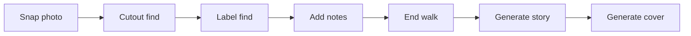
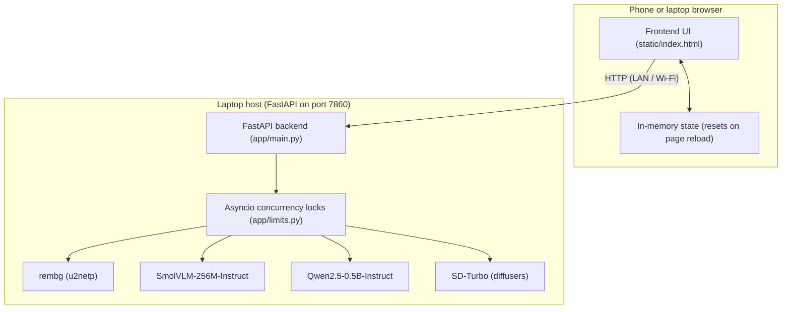

# Wayside

Collect your walk.

<!-- hero.png -->

Wayside turns an outdoor walk into a specimen collection and storybook. You photograph small finds along the path, which are cut out with rembg, identified with a vision-language model, and pinned into virtual specimen boxes. When the walk ends, a language model weaves the finds and your notes into a short story, and an image diffusion model illustrates a watercolor cover.

## How it works



## The open models

| Step | Model | Disk | First call | Warm call | Licence |
| :--- | :--- | :--- | :--- | :--- | :--- |
| Cutout | rembg (u2netp) | 4.4 MB | 13.1 s | 2.9 s | MIT (u2net: Apache-2.0) |
| Label | HuggingFaceTB/SmolVLM-256M-Instruct | 493.9 MB | 27.8 s | 31.2 s | Apache-2.0 |
| Story | Qwen/Qwen2.5-0.5B-Instruct | 953.3 MB | 85.3 s | 5.1 s | Apache-2.0 |
| Cover | stabilityai/sd-turbo | 4,922.4 MB | 62.0 s | 25.4 s | Stability AI Non-Commercial Research Community License |

Hardware: Windows laptop, Intel Core i7-1255U, 16 GB RAM, no dedicated GPU.

SD-Turbo is released as a research artifact with non-commercial terms. It cannot be used for commercial deployments without a commercial license from Stability AI.

## Architecture



## Quick start

### Prerequisites

* Python 3.10, 3.11, or 3.12
* Git
* At least 7 GB of free disk space for local model weights

### Installation steps

1. Clone the repository:
   ```bash
   git clone https://github.com/archangel2006/hacktoberfest-2026.git
   cd hacktoberfest-2026/wayside
   ```

2. Create and activate a virtual environment:
   * PowerShell:
     ```powershell
     python -m venv .venv
     .venv\Scripts\Activate.ps1
     ```
   * macOS / Linux:
     ```bash
     python3 -m venv .venv
     source .venv/bin/activate
     ```

3. Install required packages:
   ```bash
   pip install -r requirements.txt
   ```

4. Start the server:
   ```bash
   uvicorn app.main:app --host 0.0.0.0 --port 7860
   ```

The first start downloads approximately 6.4 GB of model data across rembg, SmolVLM, Qwen2.5, and SD-Turbo. On a standard broadband connection, initial model downloads require approximately 10 to 15 minutes.

### Verify it works

Run the following command in a separate terminal:
```bash
curl http://127.0.0.1:7860/api/health
```
Expected output:
```json
{"status":"ok"}
```
Then open `http://127.0.0.1:7860` in your web browser to view the loading screen.

## Use it on a walk

To use Wayside on a mobile device during a walk:

1. Identify your laptop local network IP address:
   * PowerShell: `ipconfig` (note the IPv4 address, for example `192.168.1.50`)
   * macOS / Linux: `ip a` or `ifconfig`
2. Connect both phone and laptop to the same Wi-Fi network.
3. Allow Python through the Windows Defender Firewall prompt for private networks.
4. If your router isolates wireless clients, turn on your phone mobile hotspot and connect your laptop to it.
5. Take photos with your phone camera during your outdoor walk.
6. Open `http://<laptop-ip>:7860` in your phone browser and upload the photos from your gallery.

## Configuration

| Variable | Default | Description |
| :--- | :--- | :--- |
| `PORT` | `7860` | Server HTTP listening port |
| `WAYSIDE_VISION_PROVIDER` | `local` | Vision backend provider (`local`, `hf`, `openai`, `fallback`) |
| `WAYSIDE_VISION_MODEL` | `HuggingFaceTB/SmolVLM-256M-Instruct` | Hugging Face model repository ID for vision |
| `WAYSIDE_STORY_PROVIDER` | `local` | Story backend provider (`local`, `hf`, `openai`, `fallback`) |
| `WAYSIDE_STORY_MODEL` | `Qwen/Qwen2.5-0.5B-Instruct` | Hugging Face model repository ID for story |
| `WAYSIDE_IMAGE_MODEL` | `stabilityai/sd-turbo` | Hugging Face model repository ID for cover generation |
| `WAYSIDE_IMAGE_STEPS` | `2` | Number of SD-Turbo diffusion steps |
| `MAX_UPLOAD_MB` | `8` | Maximum image upload file size |
| `RATE_LIMIT_PER_MIN` | `30` | Per-client sliding window request rate limit |
| `HF_TOKEN` | `""` | Optional Hugging Face token for serverless API fallback |

## Project structure

```
wayside/
  LICENSE                # MIT license file
  README.md              # Project documentation
  AGENT.md               # Guidelines for coding agents
  requirements.txt       # Python package dependencies
  app/                   # FastAPI backend application
    main.py              # Application entrypoint and endpoints
    config.py            # Environment configuration
    limits.py            # Concurrency locks and upload limits
    services/
      cutout.py          # Background removal via rembg
      vision.py          # Find identification via SmolVLM
      story.py           # Narrative generation via Qwen2.5
      cover.py           # Two-step cover generation via SD-Turbo
      providers.py       # Local and remote model provider abstractions
  docs/                  # Documentation files
    diagrams.md          # Architecture and flow diagrams
    sample.jpg           # Sample photo for benchmarks
    screenshots/         # Generated story cover samples
  scripts/
    benchmark.py         # Latency measurement script (<80 lines)
  static/                # Frontend web application
    index.html           # Single-page application shell
    css/                 # Theme and layout stylesheets
    js/                  # Plain ES module application views and state
  tests/                 # Pytest test suite
```

## Status and limits

| Feature | Status | Details |
| :--- | :--- | :--- |
| Background cutout | Works | Powered locally by rembg u2netp |
| Find labeling | Works | Powered locally by SmolVLM-256M-Instruct |
| Story generation | Works | Powered locally by Qwen2.5-0.5B-Instruct |
| Cover illustration | Works | Two-step prompt pipeline with SD-Turbo |
| Responsive web interface | Works | Plain ES modules across desktop, tablet, and mobile views |
| Test suite | Works | 19 passing pytest tests |
| Album persistence | Not built | Albums reside in memory only and reset on page reload |
| Remote deployment | Not built | Runs locally on laptop hardware; cloud deployment is not set up |
| Specimen-conditioned covers | Not built | Cover illustrates the story scene rather than exact photo specimens |
| Standalone phone execution | Not built | Models execute on the host computer; phone acts as a remote web client |

## Troubleshooting

| Problem | Cause | Solution |
| :--- | :--- | :--- |
| `ImportError: huggingface-hub<1.0,>=0.34.0` | Incompatible package versions | Pin `diffusers==0.32.2` and `huggingface-hub==0.36.2` |
| `UserWarning: Not enough free disk space` | Primary drive has insufficient storage | Set `HF_HOME=D:\hf_cache` on a drive with at least 10 GB space |
| Phone cannot open web page | Firewall or router client isolation | Allow Python through firewall or use phone hotspot |
| `ConnectionRefusedError` | Backend application is not running | Run `uvicorn app.main:app --host 0.0.0.0 --port 7860` |
| `UnicodeEncodeError: 'charmap'` on Windows | Terminal character encoding mismatch | Run `chcp 65001` or set `PYTHONIOENCODING=utf-8` |

## Future scope

1. Wire browser storage to IndexedDB so walk albums persist across page reloads.
2. Enable client-side caching of specimens when outdoors without active network connectivity.
3. Condition cover illustrations directly on cutout contours using ControlNet or IP-Adapter.
4. Replace browser speech synthesis with a local neural text-to-speech engine such as Piper.

## Credits and licences

| Component | Project / Model | Author | Licence |
| :--- | :--- | :--- | :--- |
| Project code | Wayside | Wayside Contributors | MIT |
| Cutout engine | rembg (u2netp) | Daniel Gatis / Xuebin Qin et al. | MIT / Apache-2.0 |
| Vision model | SmolVLM-256M-Instruct | Hugging Face | Apache-2.0 |
| Story model | Qwen2.5-0.5B-Instruct | Qwen Team / Alibaba Cloud | Apache-2.0 |
| Cover image model | sd-turbo | Stability AI | Stability AI Non-Commercial Research Community License |

Project source code is released under the [MIT License](file:///c:/Users/DELL/Downloads/hacktoberfest-2026/wayside/LICENSE). Model weights are subject to their respective authors' licenses listed above.

## Challenge notes

Built for the Hacktoberfest Open-Source AI Challenge Week 1 (Touch Grass). Entry period October 5 to 11, 2026 (deadline 11:59 PM PDT). Commits after 2026-10-12 06:59 UTC: None.
