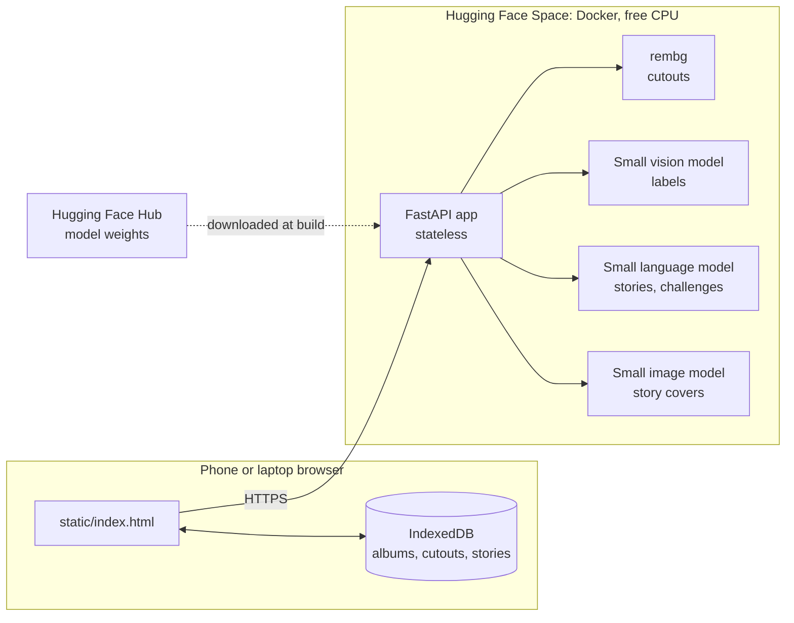
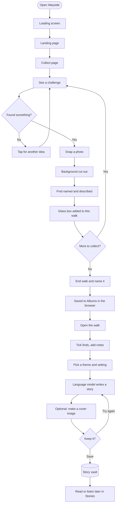
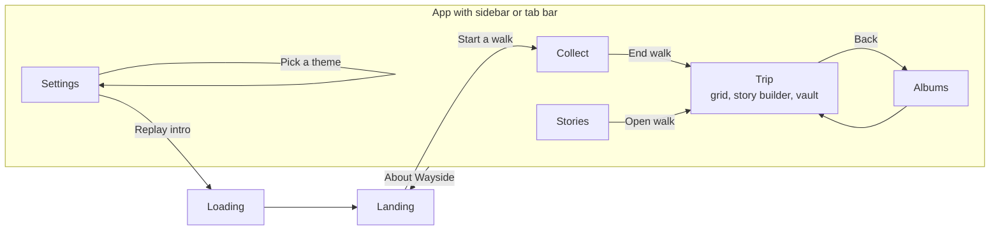
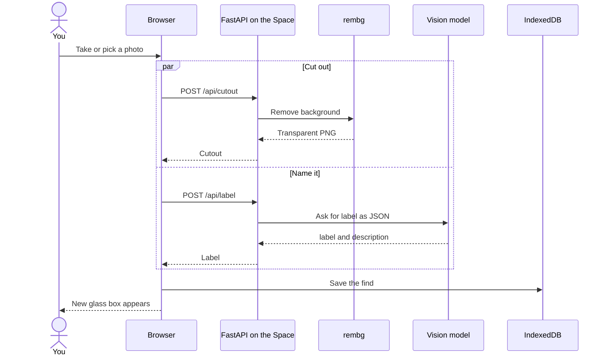
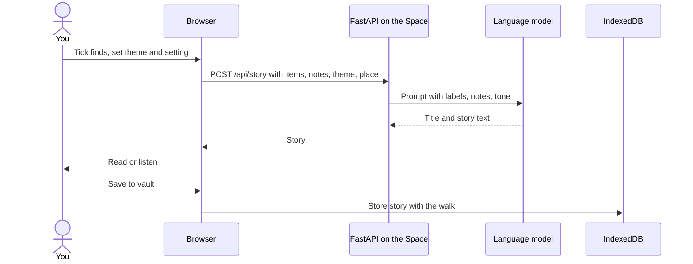
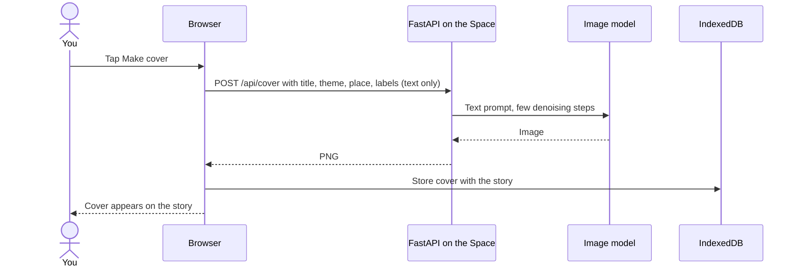
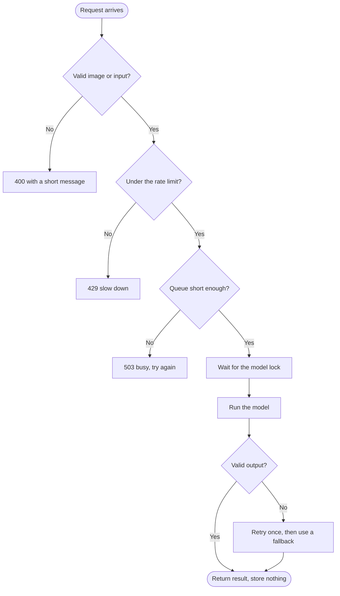
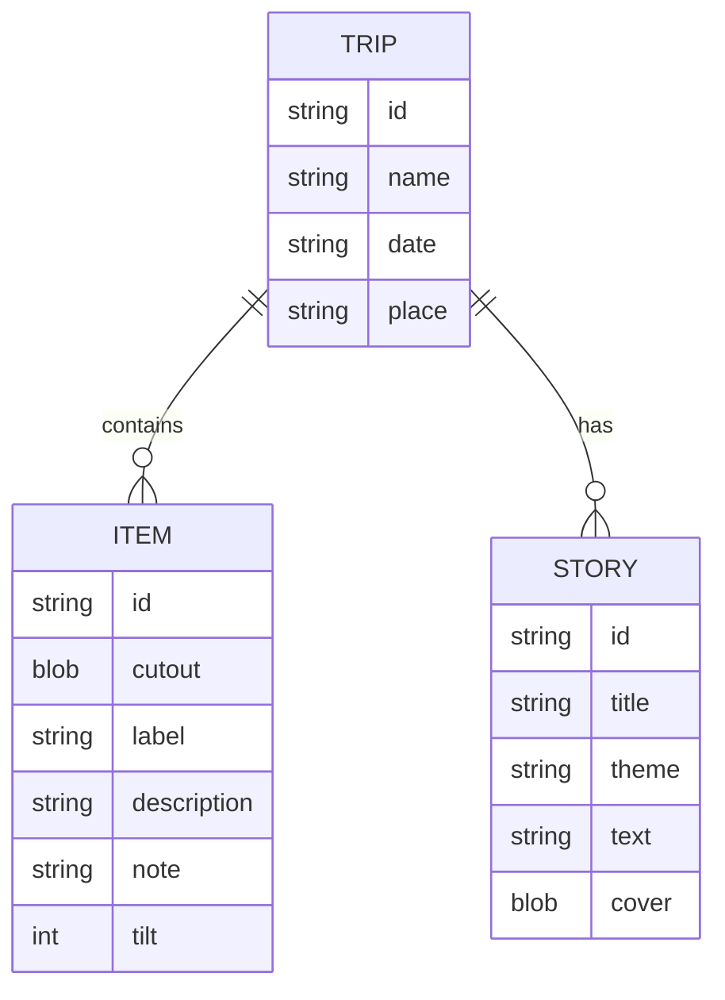

# Wayside diagrams

Paste any block into `README.md` or `docs/`. GitHub renders Mermaid code fences. For DEV, export a diagram as an image if the fence does not render.

## 1. Architecture

## 2. User flow

## 3. Page map

## 4. Snap a photo

## 5. Write a story

## 6. Make a cover

## 7. Request lifecycle on a busy server

## 8. Data model (stored in the browser)

