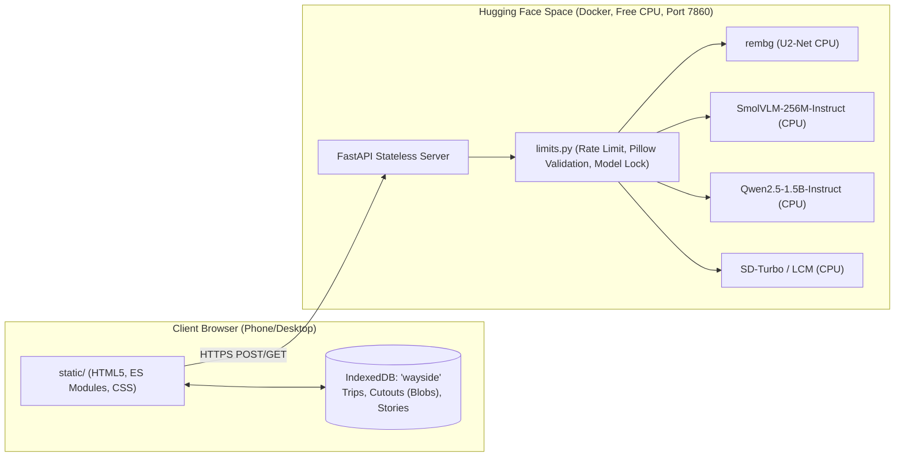

# Wayside: End-to-End Implementation Plan

> **Project Mission**: Wayside is a mobile-first web application created for the **Hacktoberfest Open-Source AI Challenge (Week 1: "Touch Grass")**. It turns an outdoor walk into a glass-box specimen collection and generates grounded short stories using 100% open-weight AI models hosted on a free Hugging Face Space.

---

## 1. Executive Summary & Core Architecture



### Architectural Axioms
1. **100% Open-Source & Load-Bearing AI**: No closed APIs (OpenAI, Anthropic, Google Gemini, etc.) even as fallback.
2. **Stateless Backend**: Server retains 0 user images or stories on disk or in server memory; albums persist strictly in client IndexedDB.
3. **Public Server Hardening**: Concurrency semaphore (one heavy inference job at a time), per-IP rate limiting, 8MB upload cap, strict Pillow verification, no stack traces leaked.
4. **Graceful Degradation**: Modular `MOCK_*` flags in `static/js/api.js` allow progressive replacement of mock components without breaking unfinished features.

---

## 2. Environment, Credentials & Manual Setup

### 2.1 Hugging Face Space Configuration
- **Repository Type**: Space
- **SDK**: `Docker`
- **Hardware**: Free CPU (2 vCPU, 16 GB RAM)
- **Port**: `7860` (Configured in README YAML header and Dockerfile)

### 2.2 Environment Variables & Secrets
While Wayside uses open models with zero cost per photo, the following environment variables configure model selection and avoid Hugging Face Hub anonymous rate limits:

| Variable | Type | Recommended Value | Purpose |
|---|---|---|---|
| `HF_TOKEN` | Secret / Optional | `hf_...` (Read token) | Authenticates model weight downloads during Docker build to bypass Hub anonymous rate limits. |
| `WAYSIDE_VISION_MODEL` | Env Var | `HuggingFaceTB/SmolVLM-256M-Instruct` | Vision-language model for naming & describing finds. |
| `WAYSIDE_STORY_MODEL` | Env Var | `Qwen/Qwen2.5-1.5B-Instruct` | Language model for stories & challenge prompts. |
| `WAYSIDE_IMAGE_MODEL` | Env Var | `stabilityai/sd-turbo` | Fast text-to-image diffusion model for story covers. |
| `MAX_UPLOAD_MB` | Env Var | `8` | Maximum file upload size limit. |
| `RATE_LIMIT_PER_MINUTE` | Env Var | `30` | Per-client IP rate limiter. |
| `MODEL_TIMEOUT_SEC` | Env Var | `60` | Maximum inference duration before returning HTTP 504. |

### 2.3 Local Development Setup
```bash
# 1. Clone repository
git clone <repo-url> wayside
cd wayside

# 2. Set up Python virtual environment
python -m venv .venv
# Windows:
.venv\Scripts\activate
# Linux/macOS:
source .venv/bin/activate

# 3. Install dependencies
pip install -r requirements.txt

# 4. Run backend locally with hot reload
uvicorn app.main:app --host 0.0.0.0 --port 7860 --reload
```

---

## 3. Phase-by-Phase Implementation Roadmap

```mermaid
gantt
    title Wayside Implementation Phases
    dateFormat  X
    axisFormat  Day %s
    section Core Infrastructure
    Phase 0: Deploy First & Docker Setup       :p0, 0, 1
    Phase 1: Cutout Service (rembg)            :p1, 1, 2
    Phase 2: Vision Model Find Labeling        :p2, 2, 3
    Phase 3: Story Generation (Qwen2.5)        :p3, 3, 4
    section Client Persistence & Refinement
    Phase 4: IndexedDB Persistence             :p4, 4, 5
    Phase 5: Dynamic Observation Challenges    :p5, 5, 6
    section Cover, Voice & Validation
    Phase 6: Story Cover Generation            :p6, 6, 7
    Phase 7: Audio Narration & Accessibility   :p7, 7, 8
    Phase 8: End-to-End Integration & Security :p8, 8, 9
```



---

### Phase 0: Baseline FastAPI Skeleton & Docker Setup ("Deploy First")
**Goal**: Get a working Dockerized FastAPI application running on Hugging Face Spaces that serves the existing static prototype and passes health checks.

#### Detailed Tasks:
1. **Create `requirements.txt`**:
   - `fastapi`, `uvicorn[standard]`, `python-multipart`, `pydantic`, `pillow`.
2. **Create `app/config.py`**:
   - Parse environment variables with defaults.
3. **Create `app/limits.py`**:
   - Setup memory limits, rate limiter skeleton, and global model execution semaphore (`asyncio.Semaphore(1)`).
4. **Create `app/main.py`**:
   - Initialize FastAPI app.
   - Endpoint: `GET /api/health` returning `{"status": "ok", "version": "1.0.0"}`.
   - Mount `static/` as static directory serving `index.html` at `/`.
5. **Create `Dockerfile`**:
   - Base image: `python:3.10-slim`.
   - Install OS dependencies (`libgl1`, `libglib2.0-0` for image processing).
   - Set up non-root user (`user:1000`) for Hugging Face Space security compatibility.
   - Expose port `7860` and launch Uvicorn.
6. **Tests to Create**:
   - `tests/test_health_and_static.py`: Verify `/api/health` and verify `GET /` serves HTML containing `Wayside`.

---

### Phase 1: Background Removal Service (`/api/cutout`) with rembg
**Goal**: Strip photo backgrounds to isolate specimens into transparent PNGs like pinned butterfly specimens.

#### Detailed Tasks:
1. **Dependencies**: Add `rembg[cpu]`, `onnxruntime` to `requirements.txt`.
2. **Build-Time Weight Pre-Download**:
   - In `Dockerfile`, add `RUN python -c "import rembg; rembg.new_session('u2net')"` to pre-cache the ONNX model into `/home/user/.u2net/u2net.onnx`.
3. **Implement `app/services/cutout.py`**:
   - Pillow preprocessing: downsample incoming image so longest side is $\le 1024\text{ px}$.
   - Pass through `rembg.remove()`.
   - Return transparent image encoded as `image/png`.
4. **Wire Route in `app/main.py`**:
   - `POST /api/cutout` receiving `file: UploadFile`.
   - Wrapped inside model execution lock and Pillow format verification.
5. **Frontend Integration**:
   - In `static/js/api.js`, introduce granular flags (`MOCK_CUTOUT = false`).
   - Connect camera shutter to real `/api/cutout`.
6. **Tests to Create**:
   - `tests/test_cutout.py`:
     - Test valid JPEG/PNG upload returns PNG with alpha channel (`RGBA`).
     - Test invalid image file returns HTTP 400.
     - Test oversized file (> 8MB) returns HTTP 413 / 400.

---

### Phase 2: Vision Model Find Labeling (`/api/label`) with SmolVLM
**Goal**: Name and describe the photographed find in 2–4 words with a short playful phrase.

#### Detailed Tasks:
1. **Dependencies**: Add `torch` (CPU wheel), `transformers`, `accelerate` to `requirements.txt`.
2. **Model Choice**: `HuggingFaceTB/SmolVLM-256M-Instruct` (compact ~256M parameters, fast on CPU).
3. **Build-Time Weight Caching**:
   - In `Dockerfile`, run script to pre-download model weights into Hugging Face cache.
4. **Implement `app/services/vision.py`**:
   - Resize image for model input (e.g. max 384–512px).
   - Structured prompt:
     ```
     You are labeling an object a person found on a walk.
     Reply with JSON only, no other text, in this exact shape:
     {"label": "<2 to 4 words>", "description": "<one short, playful phrase, under 8 words>"}
     Name the main object only. If you are unsure, give your best short guess.
     ```
   - Defensive JSON extraction: regex search for `\{.*\}`, schema validation.
   - Fallback: On failure or timeout, return `{"label": "Mystery find", "description": "hard to say"}`. Never show a raw error.
   - Benchmark: Ensure CPU execution time is under 15–20 seconds.
5. **Route in `app/main.py`**:
   - `POST /api/label` accepting `file: UploadFile`.
6. **Frontend Integration**:
   - In `static/js/api.js`, enable `MOCK_LABEL = false`.
   - `api.snap` runs `/api/cutout` and `/api/label` in parallel via `Promise.all`.
7. **Tests to Create**:
   - `tests/test_vision.py`:
     - Test valid specimen image returns valid `{label, description}` JSON.
     - Test parser resilience against markdown-fenced and non-JSON model output.

---

### Phase 3: Story Generation Service (`/api/story`) with Qwen2.5-1.5B
**Goal**: Generate grounded 90–140 word micro-stories that weave real finds, user notes, theme, and place together.

#### Detailed Tasks:
1. **Model Selection**: `Qwen/Qwen2.5-1.5B-Instruct` (or `HuggingFaceTB/SmolLM2-1.7B-Instruct`).
2. **Implement `app/services/story.py`**:
   - Input schema validation via Pydantic: `items` (list of `{label, description, note}`), `theme`, `place`.
   - Prompt sanitization: treat user text as delimited data blocks (defend against prompt injection).
   - Prompt construction:
     ```
     Write a short story of 90 to 140 words in a {theme} tone, set near {place}.
     Use every one of these finds, in any order:
     {items as "label: description. Note: note"}
     Weave the person's notes in as real memories.
     Return a title on the first line, then a blank line, then the story. No other text.
     ```
   - Generation parameters: `temperature=0.6`, `max_new_tokens=220`, repetition penalty.
   - Output parser: splits line 1 into `title`, remainder into `text`.
3. **Route in `app/main.py`**:
   - `POST /api/story`.
4. **Frontend Integration**:
   - Set `MOCK_STORY = false` in `static/js/api.js`.
   - Remove `fakeStory()`.
5. **Tests to Create**:
   - `tests/test_story.py`:
     - Test story generation with 1, 3, and 5 finds.
     - Test handling when `place` is empty or `note` is empty.
     - Test prompt injection attempts (e.g. notes containing "Ignore previous instructions").

---

### Phase 4: IndexedDB Persistence & Browser Storage Wiring
**Goal**: Ensure walk albums, specimens, and stories survive page reloads and browser restarts without any server-side database.

#### Detailed Tasks:
1. **Refactor `static/js/storage.js`**:
   - Maintain `trips` object store.
   - Convert `blob:` object URLs to native `Blob` objects before storage.
   - Create URL objects (`URL.createObjectURL(blob)`) on retrieval.
2. **Wire Storage into State & Views**:
   - `main.js`: On application boot, invoke `loadTrips()`. If empty, populate with initial tutorial sample or empty state.
   - `views/collect.js`: When saving an ended walk (`#save`), write to `saveTrip(t)`.
   - `views/trip.js`: When notes are modified or a story is saved to vault, persist immediately.
   - Delete/edit handlers: Wire up deletion in `storage.js`.
3. **Defensive Error Handling**:
   - Handle private browsing modes where IndexedDB throws `QuotaExceededError` or is disabled.
4. **Tests to Create**:
   - `tests/test_storage.html` & `tests/test_frontend_storage.py`:
     - Script verifying IndexedDB records can be created, updated, retrieved, and that binary image Blobs retain integrity across transactions.

---

### Phase 5: Dynamic Observation Challenges (`/api/challenge`)
**Goal**: Deliver contextual one-line walking challenges tailored to time of day and collected finds.

#### Detailed Tasks:
1. **Implement `app/services/challenge.py`**:
   - Accept optional `time_of_day` (morning, afternoon, dusk, night) and `count`.
   - Generate single-sentence prompts under 14 words.
   - Fast execution: use smaller token budget (`max_new_tokens=40`).
2. **Route in `app/main.py`**:
   - `GET /api/challenge`.
3. **Frontend Integration**:
   - Wire "Can't find anything? Give me another idea" button in `views/collect.js`.
   - Fallback: Instantly fall back to `PROMPTS` array in `static/js/data.js` on network failure.
4. **Tests to Create**:
   - `tests/test_challenge.py`: Test endpoint responses and verify string length constraints.

---

### Phase 6: Story Cover Generation (`/api/cover`) with SD-Turbo
**Goal**: Generate a soft illustrated cover scene based on story theme, place, and labels (text only, no user photos).

#### Detailed Tasks:
1. **Model Evaluation & License Check**:
   - Check `stabilityai/sd-turbo` or lightweight CPU pipeline (`latent-consistency/lcm-lora-sdv1-5` or small ONNX LCM model).
   - Confirm non-commercial vs open license compatibility for Hacktoberfest submission.
2. **Implement `app/services/cover.py`**:
   - Single-step or 4-step generation on CPU.
   - Image resolution: $384 \times 384$ or $512 \times 512$ (to maintain CPU generation times under 45–60s).
   - Negative prompt: `"text, letters, watermark, signature, faces, deformed, realistic photo"`.
3. **Route in `app/main.py`**:
   - `POST /api/cover` returning `image/png`.
4. **Frontend Integration**:
   - Replace canvas stand-in painter `drawCover` in `static/js/cover.js` and `api.js`.
   - Display loading status while generating; allow user to read story without waiting.
5. **Tests to Create**:
   - `tests/test_cover.py`: Verify valid PNG output and text prompt building.

---

### Phase 7: Audio Narration & Accessibility Refinement
**Goal**: Allow users to listen to their walk story on the way home.

#### Detailed Tasks:
1. **Evaluate Audio Solutions**:
   - Primary: Browser Web Speech API (`SpeechSynthesis`) with pause, resume, and rate controls in `static/js/voice.js`.
   - Optional Server TTS: `piper-tts` CPU binary if local voice quality requires upgrade.
2. **UX Polish**:
   - Mobile tap targets $\ge 44\text{ px}$.
   - Ensure screen reader support (`aria-live="polite"` for loading states, high-contrast themes).
3. **Tests to Create**:
   - `tests/test_voice_support.js`: Unit test speech synthesis event dispatching.

---

### Phase 8: End-to-End Integration, Security Audit & Space Deployment
**Goal**: Full system validation on real devices under real-world network conditions.

#### Detailed Tasks:
1. **Security & Abuse Mitigation Audit (`app/limits.py`)**:
   - Reject uploads $> 8\text{ MB}$.
   - Verify every file with `PIL.Image.open()`.
   - Enforce 30 requests/minute per client IP.
   - Reject concurrent model requests with HTTP 503 ("Server busy, try again").
   - Strip internal error traces from API responses.
2. **Automated End-to-End Test Suite**:
   - `tests/test_e2e_pipeline.py`: Simulates entire walk lifecycle:
     - 1. Check `/api/health`
     - 2. Fetch challenge `/api/challenge`
     - 3. Upload photo to `/api/cutout` & `/api/label` concurrently
     - 4. Request story `/api/story`
     - 5. Request cover `/api/cover`
3. **Manual Verification Protocol**:
   - Open deployed Hugging Face Space on iOS Safari and Android Chrome using mobile data.
   - Complete 3 photo snaps, finish walk, save to album.
   - Generate story and cover image.
   - Refresh browser and verify walk data rehydrates from IndexedDB.

---

## 4. Test Files Summary

| Test File | Type | Purpose | Covered Phase |
|---|---|---|---|
| `tests/test_health_and_static.py` | Integration | Validates `/api/health` and static frontend file serving. | Phase 0 |
| `tests/test_cutout.py` | Unit / Service | Verifies `rembg` background removal, RGBA output, and upload size limits. | Phase 1 |
| `tests/test_vision.py` | Unit / Service | Validates vision model JSON prompt, parser, and fallbacks. | Phase 2 |
| `tests/test_story.py` | Unit / Service | Tests Qwen2.5 story length, format compliance, and injection defense. | Phase 3 |
| `tests/test_storage.html` | Browser Unit | Tests IndexedDB object store CRUD and binary Blob persistence. | Phase 4 |
| `tests/test_challenge.py` | Unit / Service | Validates contextual challenge prompt generator. | Phase 5 |
| `tests/test_cover.py` | Unit / Service | Validates SD-Turbo cover prompt construction and image output. | Phase 6 |
| `tests/test_e2e_pipeline.py` | E2E Integration | Tests full backend API pipeline from snap to story and cover. | Phase 8 |
| `tests/test_security_limits.py` | Security | Verifies rate limits (429), upload caps (413), and queue lock (503). | Phase 8 |

---

## 5. Definition of Done Checklist

- [ ] All 4 open models run strictly on Hugging Face free CPU without external APIs.
- [ ] Model weights are pre-cached in the Docker image during build.
- [ ] The app is deployed and accessible via public Hugging Face Space URL.
- [ ] Shutter snaps real photos, produces transparent specimen cutouts and names them.
- [ ] Stories are generated from real user finds and notes.
- [ ] Walks, specimens, and stories persist across page reloads in IndexedDB.
- [ ] The UI gracefully displays loading, waking, and busy states without freezing.
- [ ] All unit, integration, and security tests pass.
- [ ] `README.md` and DEV challenge submission copy are accurate and honest.
